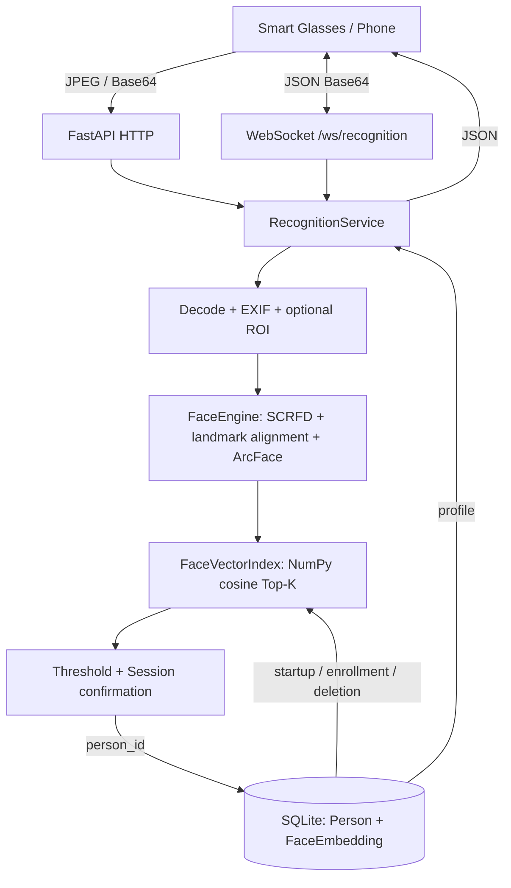

# 课程实验人脸识别服务器

Python 3.11+ / FastAPI / SQLAlchemy / SQLite / InsightFace ArcFace / ONNX Runtime。仅供知情同学参加的本地课程实验；提供注册、真实人脸检测与对齐、512 维特征提取、1:N 匹配、HTTP、WebSocket、多帧确认和阈值标定。识别不会自动注册陌生人。

## 架构与目录



```text
face-recognition-server/
├── app/
│   ├── main.py                    # factory, lifespan, error envelopes, bounded body
│   ├── api/                       # persons, recognition, health, WebSocket, dependencies
│   ├── core/                      # validated settings, JSON logging, exceptions
│   ├── schemas/                   # typed request/response envelopes and profiles
│   ├── services/
│   │   ├── face_engine.py         # version-specific InsightFace adapter
│   │   ├── face_matcher.py        # FaceVectorIndex + vectorized NumPy matcher
│   │   ├── person_service.py      # atomic batch enrollment and centroid
│   │   ├── recognition_service.py # shared recognition pipeline
│   │   ├── session_service.py     # consecutive frames, debounce, TTL
│   │   └── runtime.py             # bounded single worker, index/cache lifecycle
│   ├── repositories/             # person and embedding queries
│   ├── models/                   # database, Person, FaceEmbedding
│   └── utils/                    # image decoding, vectors, Timer
├── data/{face_models,database,temp,faces,test_images}/
├── scripts/                      # init, download, enroll, reload, benchmark, calibrate
├── examples/{http_client,websocket_client}.py
├── tests/                        # mock business tests + optional real model tests
├── requirements.txt              # server/test dependencies without model build
├── requirements-model.txt        # full real inference dependencies
├── requirements-lock.txt         # exact versions installed in this Windows environment
├── run.py
├── .env.example
├── Dockerfile
└── docker-compose.yml
```

检测和 embedding 保留在一个 FaceEngine 适配器内，避免无实际职责的额外包装。模型在 lifespan 中初始化一次；每个请求只对输入照片推理，注册照片不会在识别时重跑模型。单线程 executor 执行模型、SQLite 操作和状态修改，保护非线程安全组件，并让事件循环继续处理网络事件；队列达到上限返回 RATE_LIMITED。

## Windows PowerShell 安装与启动

先安装 Python 3.11 或 3.12。确认 `python --version`；本机器系统 `python` 为 3.8，但本项目现有 `.venv` 是 **3.11.15**，可以直接使用下面的 `.venv\Scripts\python.exe`。不需要激活脚本。

```powershell
cd D:\ai面试官\face-recognition-server
# 新环境中执行；本项目已存在可用 .venv，无需重复创建
python -m venv .venv
.\.venv\Scripts\python.exe -m pip install --upgrade pip
.\.venv\Scripts\python.exe -m pip install -r requirements-model.txt
Copy-Item .env.example .env
.\.venv\Scripts\python.exe scripts/init_db.py
# 首次联网下载官方模型；本次开发已下载完成
.\.venv\Scripts\python.exe scripts/download_models.py
.\.venv\Scripts\python.exe run.py
```

若只有系统 Python 3.8，可安装 Python 3.11 后使用完整路径创建虚拟环境；装有 uv 时可用 `uv venv --python 3.11 .venv` 和 `uv pip install --python .venv/Scripts/python.exe -r requirements-model.txt`。

InsightFace 0.7.3 在 Windows 上可能需要 Visual Studio C++ Build Tools 编译扩展，本次环境编译安装成功。只想运行 mock 测试可先安装 `requirements.txt`，但这样不能真实识别。

Linux：

```bash
cd face-recognition-server
python3.11 -m venv .venv
source .venv/bin/activate
pip install -r requirements-model.txt
cp .env.example .env
python scripts/init_db.py
python scripts/download_models.py
python run.py
```

也可在项目目录运行 `uvicorn app.main:app --host 0.0.0.0 --port 8000 --workers 1 --ws-max-size 11250346`。`python run.py` 自动根据图片限制设置 WebSocket 帧大小。不要使用多个 worker，否则索引、限流、请求缓存和 session 不共享。默认端口忙时在 `.env` 设置 `APP_PORT=18081`，客户端 URL 同步修改。

访问 [Swagger UI](http://127.0.0.1:8000/docs)、[ReDoc](http://127.0.0.1:8000/redoc)、[健康检查](http://127.0.0.1:8000/health)。

## 模型和离线运行

固定 `insightface==0.7.3`、`onnxruntime==1.21.1`，使用 `buffalo_l` 包中的 SCRFD 检测器和 ArcFace 识别器。适配器调用 detector.detect 获取所有脸与五点关键点，recognizer.get 内部调用 norm_crop 对齐后生成 embedding；只启用 detection 和 recognition。参考 [固定版本 FaceAnalysis 源码](https://github.com/deepinsight/insightface/blob/v0.7/python-package/insightface/app/face_analysis.py) 与 [模型说明](https://github.com/deepinsight/insightface/tree/master/python-package)。

`ALLOW_MODEL_DOWNLOAD=false` 为默认值，服务器启动不主动联网下载。首次明确运行 download_models.py，或把已下载的模型复制到：

```text
data/face_models/models/buffalo_l/det_10g.onnx
data/face_models/models/buffalo_l/w600k_r50.onnx
```

官方完整模型包中还含其他 ONNX 文件，可保留。部署到完全离线电脑时，还需提前准备 Python 和依赖 wheel；仅复制模型不等于已安装依赖。模型初始化失败会记录真实异常，健康检查显示 degraded，识别返回 MODEL_NOT_READY。`FACE_DEVICE=cuda` 会优先尝试 CUDA，缺少可用 provider 或初始化失败则回退 CPU；GPU 需自行安装与驱动匹配的 onnxruntime-gpu，避免与 CPU 包并装。

## 数据库和索引

| 表 | 字段 |
|---|---|
| persons | id PK, person_id UNIQUE, name, student_no, school, major, description, created_at, updated_at |
| face_embeddings | id PK, person_id FK, embedding BLOB, model_name, embedding_dim, image_source, is_centroid, created_at |

特征是经过 L2 normalize 的 little-endian float32 BLOB，由 serialize_embedding / deserialize_embedding 转换，拒绝零向量、非有限值及维度错误。每人最多 5 张注册照片，分别存样本向量，另外保存一条归一化平均向量。平均向量不参与默认 max 评分，也不计入 health 的 registered_embeddings。

启动从 SQLite 读取样本构建 N×D 矩阵；查询用 `matrix @ query` 一次计算 cosine，再按 person_id 聚合并求 Top-K。`PERSON_SCORE_STRATEGY=max|mean|top_n_mean`，默认 max。FaceVectorIndex 抽象了 replace / match，后续可接 FAISS、Milvus 或 Qdrant。变更模型须重新注册，不混算不同模型的特征。

注册前验证整个批次，任一照片失败则本批次零写入。注册和删除后重建索引并清空识别缓存与会话，避免旧结果继续返回。SQLite 启用外键，删除人物级联删除样本和平均向量。人物创建后注册失败时人物档案仍保留，可以重试上传。

## 人物注册

服务启动后，自己建立 `data/test_images/person1/`，放入 1～5 张经过参与者同意的单人正面/侧面照片。原图默认不保存到数据库或服务器照片目录；只存向量和源文件名。

PowerShell：

```powershell
.\.venv\Scripts\python.exe scripts/register_person.py `
  --person-id student_001 `
  --name "测试同学1" `
  --student-no 20260001 `
  --school "Test University" `
  --major "Software Engineering" `
  --images ./data/test_images/person1/
```

Linux：

```bash
python scripts/register_person.py \
  --person-id student_001 --name "Test Person 1" \
  --images ./data/test_images/person1/
```

此脚本通过 HTTP 创建人物并上传注册照片，确保运行中的索引同步。已有 person_id 时不修改档案，继续尝试上传。新增样本与已有样本合计不得超过 5；第一版替换照片需删除人物后重建。

## JSON / HTTP API

所有业务响应含 `type`、`request_id`、`timestamp`（Unix 毫秒）、`success`，失败含 `error: {code,message}`。识别 body/form 的 request_id 在 JSON 中原样返回；人物、健康、统计等接口使用 `X-Request-ID`，未提供则生成，响应同时设置该 header。响应 header 中的 ID 使用 UTF-8 百分号编码（普通字母、数字、下划线、连字符不变），避免中文或控制字符破坏 HTTP；需要读取 header 时先 URL-decode，JSON 字段不需要解码。

| 方法与路径 | 输入 | 结果 |
|---|---|---|
| POST /api/v1/persons | JSON PersonCreate | person_result；201 |
| POST /api/v1/persons/{person_id}/faces | multipart，重复 files 字段 1～5 个 | registration_result |
| GET /api/v1/persons | offset、limit（最多 500） | persons_result |
| GET /api/v1/persons/{person_id} | 路径 person_id | person_result |
| DELETE /api/v1/persons/{person_id} | 路径 person_id | delete_result |
| POST /api/v1/recognize/image | multipart：file，request_id/device_id/session_id 可选 | recognition_result |
| POST /api/v1/recognize/base64 | JSON，见下 | recognition_result |
| GET /health | 无 | readiness、人物与样本数量 |
| GET /api/v1/stats | DEBUG=true | 模型/provider/维度、平均处理时间 |
| POST /api/v1/index/reload | DEBUG=true | index_reloaded |

创建人物例子：

```json
{"person_id":"student_001","name":"测试同学1","student_no":"20260001","school":"Test University","major":"Software Engineering","description":"Course testing participant"}
```

单帧 Base64：

```json
{
  "type":"recognize",
  "request_id":"req_001",
  "device_id":"glass_001",
  "image_format":"jpeg",
  "image_base64":"...",
  "stable_frames":1
}
```

不带 session_id 的 HTTP 是独立单帧识别。连续帧请传固定 session_id，每帧不同 request_id，默认连续 3 帧确认。若有 session_id 且只需单帧，也可传 stable_frames=1。

可选 face_box：`{"x":420,"y":180,"w":260,"h":320}`，坐标针对 **EXIF 旋转校正后的图片**。multipart 中 face_box 是这个对象的 JSON 字符串。服务端校验边界并在 ROI 内重新检测；ROI 外的脸不计入 ROI 检测，多脸默认拒绝。`ALLOW_MULTIPLE_FACES=true` 明确启用后，识别选择检测到的最大脸，注册始终拒绝多脸。

image_format 接受 jpg/jpeg/png，支持纯 Base64 和 JPEG/PNG data URL。实际解码按文件内容校验；文件名后缀用于 multipart 的额外校验。单图默认最大 8 MiB，并限制解码像素数；原始识别帧默认不落盘。

成功响应（人物实际还包含注册时间字段）：

```json
{
  "type":"recognition_result",
  "request_id":"req_001",
  "timestamp":1791529200000,
  "success":true,
  "error":null,
  "face_detected":true,
  "matched":true,
  "person":{"person_id":"student_001","name":"测试同学1"},
  "match":{"similarity":0.8321,"threshold":0.65},
  "stability":{"confirmed":true,"consistent_frames":1,"confirmed_person_id":"student_001"},
  "top_k":[{"person_id":"student_001","similarity":0.8321}],
  "processing":{"decode_ms":2,"face_detection_ms":12,"embedding_ms":21,"matching_ms":2,"database_ms":3,"total_ms":42}
}
```

示例数值仅说明协议，不是本机性能或真实识别报告。`DEBUG=false` 时 top_k 为 null；`RETURN_DEBUG_INFO=false` 时 processing 为 null。计时不含排队和网络传输，stats 为实际推理请求均值，缓存命中不重复计数。

`best_similarity >= FACE_MATCH_THRESHOLD` 才可认定当前帧匹配。连续帧还需确认后才返回人物。在新人物确认过程中 matched=false、person=null、PENDING_CONFIRMATION，stability.confirmed_person_id 仍保留上一位已确认人员，客户端应保留旧卡片直到新人物确认。未知帧返回 UNKNOWN_FACE，不会假装匹配旧人物。NO_FACE 和 UNKNOWN_FACE 的 success=true 表示请求已完成；多脸 success=false。空注册库在检测到有效单脸后返回 NO_REGISTERED_FACES。

独立测试客户端：

```powershell
.\.venv\Scripts\python.exe examples/http_client.py --image ./data/test_images/new.jpg
.\.venv\Scripts\python.exe examples/http_client.py --image ./data/test_images/new.jpg --base64
.\.venv\Scripts\python.exe examples/websocket_client.py --image ./data/test_images/new.jpg --frames 3
```

## WebSocket 协议和会话

连接 `ws://<服务器IP>:8000/ws/recognition`，发送上述 recognize JSON。依次返回 recognition_result。未提供 session_id 时连接自动创建独立会话。device_id 参与会话和缓存隔离，不能用其绕过按网络 peer 的限流。

```json
{"type":"ping","request_id":"p1"}
{"type":"person_left","request_id":"leave1","device_id":"glass_001","session_id":"s1"}
{"type":"clear","request_id":"clear1","device_id":"glass_001","session_id":"s1"}
```

分别返回 `type=pong` 或 `type=clear`，均含 request_id/timestamp。清理时 device_id/session_id 必须与识别时一致。没有新消息的 session 在 SESSION_TIMEOUT_SECONDS 后过期，下一帧从零开始；当前实现不主动推送超时 clear。显式 session 可跨连接恢复，连接临时 session 断开后清除。

重复请求缓存：同一 peer/device/session/request_id、同一图片和参数在 30 秒内复用结果；不同图片或参数复用同一 ID 返回 INVALID_REQUEST。重发不会累计 stable_frames。TTLCache 容量可配置。删除/注册/重建/clear 会使相关缓存失效。HTTP 和 WebSocket 共用每 peer 每秒 5 次的滑动窗口限流，超过返回 RATE_LIMITED；模型队列另有上限。

## 与已有 Java / 眼镜端的关系

本仓库现有协议位于 `../docs/SMART_GLASSES_WEBSOCKET_API.md`：Java `:8080/ws` 接收 `type=face,img,face_box:[x,y,w,h]`，返回 person_info。本 Python 服务接收 `type=recognize,image_base64,face_box:{x,y,w,h}`，返回 recognition_result。**两者不是同一条协议，未修改现有客户端或 Java 服务。** Python 人物是课程测试档案，未连接 Candidate/Job/Interview 数据。

课程客户端直接接 Python 时：修改测试连接 URL，使用新字段，并把 person 渲染为卡片。若未来通过 Java 网关转发，需要明确实现 FaceCandidateResolver HTTP 适配、维护经过验证的 ID 映射，并由网关转换协议；当前未做自动 ID 绑定。不要把本课程测试服务直接接入真实招聘决策流程。

## 阈值标定

0.65 仅为启动示例，不能当作正确阈值。用实际设备、光照、距离拍摄照片，按以下结构分组，标定照片与注册照片分开；另保留独立验收集。

```text
dataset/
  student_001/{a.jpg,b.jpg,c.jpg}
  student_002/{a.jpg,b.jpg,c.jpg}
  student_003/{a.jpg,b.jpg,c.jpg}
```

```powershell
.\.venv\Scripts\python.exe scripts/calibrate_threshold.py --dataset ./dataset --output calibration.csv --max-far 0.01
```

工具自动提取真实 embedding、同人 positive 和异人 negative pairs，在多个阈值输出 accuracy/precision/recall/FAR/FRR/TP/FP/TN/FN。推荐满足 max-far 的阈值中召回率最高者；不满足时明确报告。每类最多采样 max-pairs 个比较，使用固定随机种子，内存有界；遍历比较仍是 O(N²)，适合课程规模。

也支持已有分数对 `--pairs-csv pairs.csv`，列为 `label,similarity`（1 同人、0 异人）。FAR=FP/(FP+TN)，FRR=FN/(FN+TP)。将推荐值写入 `.env` 的 FACE_MATCH_THRESHOLD 并重启。不同模型和摄像头的最佳阈值不同，pair 指标也不能替代 1:N、未知人物、多帧的实测验收。

## 性能与测试

```powershell
.\.venv\Scripts\python.exe -m pytest -q
.\.venv\Scripts\python.exe scripts/benchmark.py --image ./data/test_images/new.jpg --iterations 100
.\.venv\Scripts\python.exe scripts/rebuild_face_index.py
```

benchmark 给出平均/P50/P95/P99、阶段均值、错误计数与 throughput；默认请求间隔 0.21 秒避免 5 RPS 限流。吞吐同时区分含间隔和不含间隔估算。极限测试可临时调高 MAX_REQUESTS_PER_SECOND 并用 `--interval 0`，不要把限流错误当有效识别速度。

真实模型集成测试：

```powershell
# 本次已执行：真实模型启动和空白图检测，无真人照片
$env:FACE_RUN_MODEL_SMOKE="1"
.\.venv\Scripts\python.exe -m pytest -q
# 需要自行准备有授权的单人照片
$env:FACE_INTEGRATION_IMAGE=(Resolve-Path ./data/test_images/new.jpg).Path
.\.venv\Scripts\python.exe -m pytest -q -m integration
```

单元测试通过注入 MockFaceEngine 测试业务，正常应用没有假 embedding、随机分数或模拟识别成功。真人真实 embedding 测试未设 FACE_INTEGRATION_IMAGE 时明确 skip；模型不可用但主动开启集成测试时会 fail，不能伪装成功。

## 错误码与排错

| 错误码 | 含义 |
|---|---|
| INVALID_REQUEST | 请求/schema/JSON 无效或 request_id 被不同内容复用 |
| INVALID_BASE64 | 严格 Base64 解码失败 |
| INVALID_IMAGE / INVALID_IMAGE_FORMAT | 空图片或不支持的格式 |
| IMAGE_TOO_LARGE | 字节、像素、消息或请求体超限 |
| IMAGE_DECODE_FAILED | 无法解码或损坏图片 |
| INVALID_FACE_BOX | ROI 参数或边界错误 |
| NO_FACE / MULTIPLE_FACES | 无脸 / 多脸拒绝 |
| FACE_EXTRACTION_FAILED | 关键点、推理或向量无效 |
| UNKNOWN_FACE | 当前帧最佳分数低于阈值 |
| NO_REGISTERED_FACES | 尚无有效注册向量 |
| PENDING_CONFIRMATION | 等待连续帧确认 |
| PERSON_NOT_FOUND / PERSON_ALREADY_EXISTS | 人物不存在 / 重复 ID |
| MODEL_NOT_READY | 依赖、模型文件或 provider 初始化失败 |
| DATABASE_ERROR | 数据库或索引不可用、模型/维度不一致 |
| RATE_LIMITED | 速率、队列或会话数量超限 |
| INTERNAL_ERROR | 其他服务错误（真实堆栈只写服务器日志） |

没有模型：检查 data/face_models/models/buffalo_l，运行 download_models.py。注册失败：检查照片是否单人、清晰、格式正确。识别总是 unknown：不要盲目降阈值，先检查注册模型、照片质量和标定集。看不到 stable confirmed：每帧需新 request_id，session/device 保持一致，默认至少 3 帧。localhost 只表示当前设备，手机端必须填电脑局域网 IP，并允许测试端口通过 Windows 防火墙。默认 8000 若被其他项目占用，换 APP_PORT。

示例客户端和脚本明确直连服务器，不读取系统 HTTP/WebSocket 代理设置，防止本机代理拦截局域网或 localhost 联调。本次独立 Uvicorn 测试遇到此问题后已验证修复。

## 隐私与当前限制

识别原图默认不落盘；SAVE_DEBUG_IMAGES=true 才写入 data/temp/debug，文件名随机生成。日志不写 Base64、二进制或完整向量，包含 request_id/device_id/session_id、匹配结果、分数、耗时，异常有明确堆栈。测试结束删除测试照片、数据库、调试图及标定数据。Git 忽略这些数据和模型，不能把真人照片或 embedding 提交到版本库。

当前为可信局域网课程原型，无账号鉴权、TLS、活体检测或跨进程状态同步；不要暴露到公网。单 worker 以稳定和可调试为先；GPU、Docker 实际运行与真人识别准确率需目标环境验证。图片大小和像素数均有限制，但仍应使用可信测试客户端。InsightFace 预训练模型的用途和授权以官方模型说明为准。

后续可替换 FaceVectorIndex，增加 Redis session、PostgreSQL、GPU/ONNX 优化和 batch inference。Docker 是可选项：先准备 `.env` 和本地模型，再 `docker compose up --build`，data 挂载保留；Windows 原生运行仍为首选。
